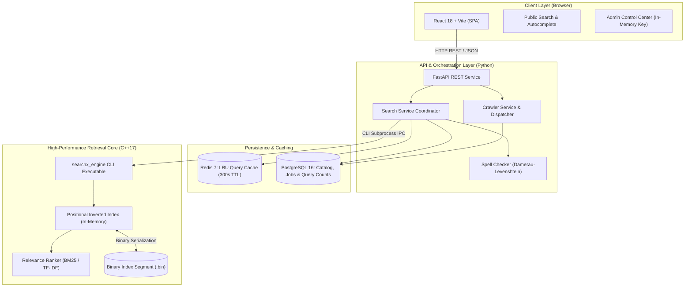
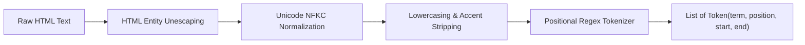
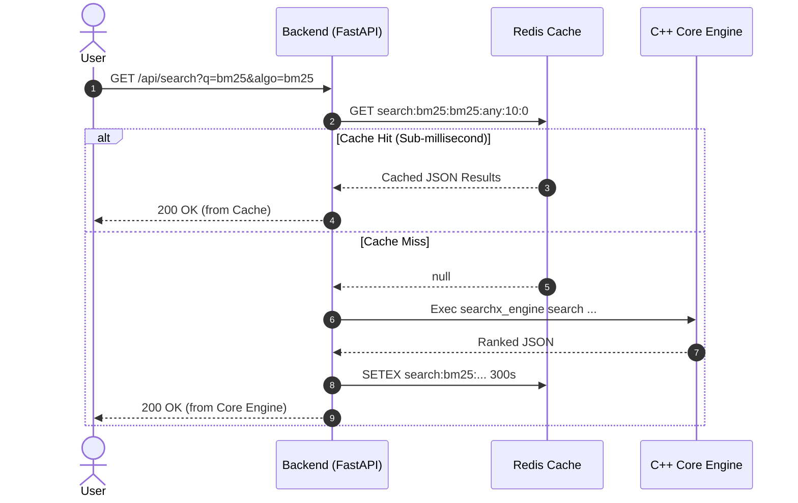
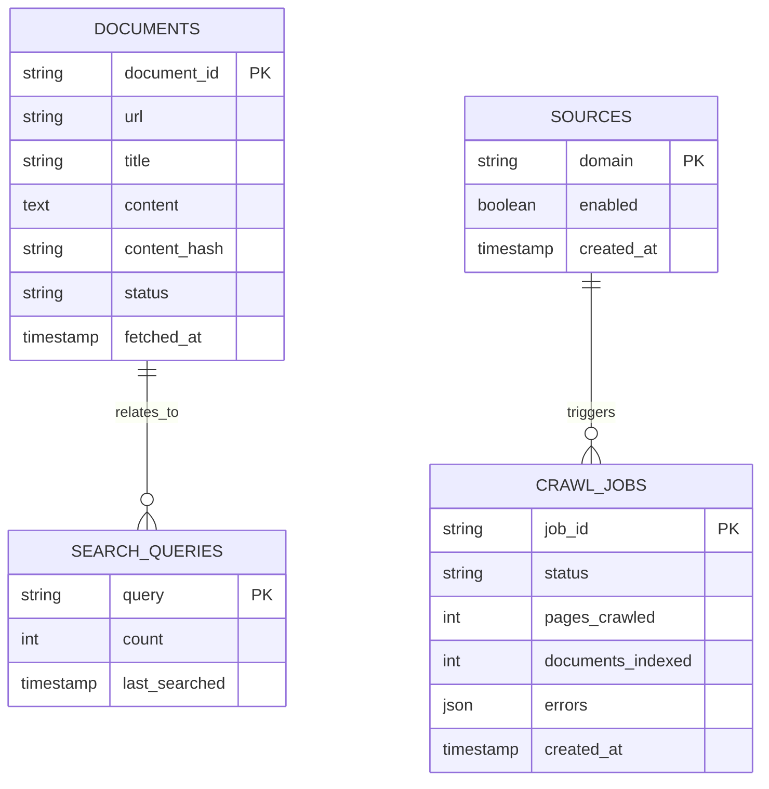
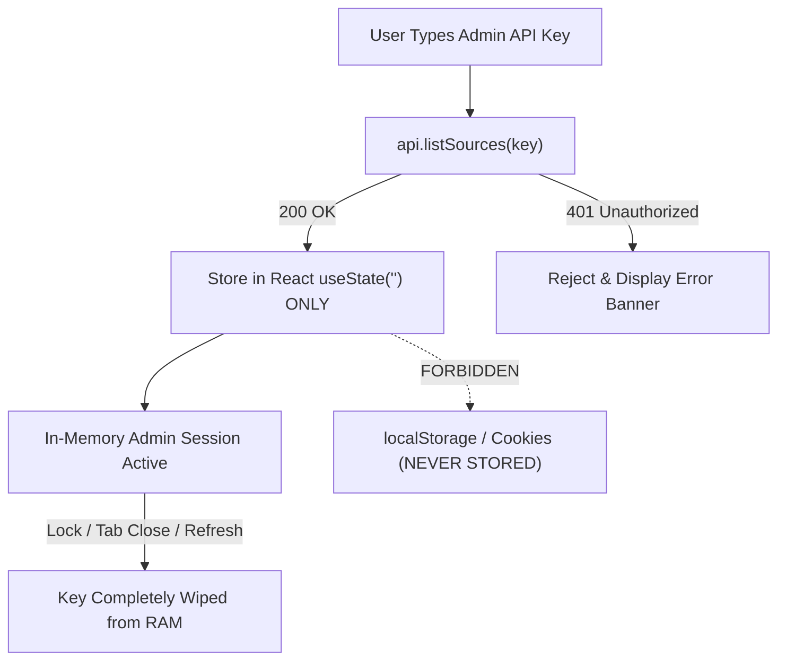

# SearchX: Architecture, Core Concepts & Data Structures Guide

This document serves as an exhaustive technical guide to **SearchX**. It explains every core concept, data structure, mathematical formula, algorithmic decision, and architectural boundary implemented across the entire system — from C++ low-level memory layout to the React frontend.

---

## Table of Contents

1. [High-Level Architecture & System Topology](#1-high-level-architecture--system-topology)
2. [C++ Retrieval Core: Inverted Index & Memory Layout](#2-c-retrieval-core-inverted-index--memory-layout)
   - [What is an Inverted Index?](#what-is-an-inverted-index)
   - [Data Structures Used & Algorithmic Complexities](#data-structures-used--algorithmic-complexities)
   - [Positional Indexing & Memory Optimization](#positional-indexing--memory-optimization)
   - [Fast Document Removal & Deduplication](#fast-document-removal--deduplication)
3. [Relevance Ranking & Scoring Mathematics](#3-relevance-ranking--scoring-mathematics)
   - [Boolean Query Matching (AND / OR)](#boolean-query-matching-and--or)
   - [TF-IDF (Term Frequency – Inverse Document Frequency)](#tf-idf-term-frequency--inverse-document-frequency)
   - [Okapi BM25 Ranking](#okapi-bm25-ranking)
   - [Deterministic Tie-Breaking](#deterministic-tie-breaking)
4. [Binary Serialization & Persistence Protocol](#4-binary-serialization--persistence-protocol)
5. [Crawler, Parser & Security Pipeline](#5-crawler-parser--security-pipeline)
   - [SSRF (Server-Side Request Forgery) Defense](#ssrf-server-side-request-forgery-defense)
   - [Domain Allowlisting & Politeness Engine](#domain-allowlisting--politeness-engine)
   - [Unicode Normalization & Positional Tokenizer](#unicode-normalization--positional-tokenizer)
6. [Spell Checking & Query Correction](#6-spell-checking--query-correction)
   - [Damerau-Levenshtein Distance](#damerau-levenshtein-distance)
   - [Vocabulary-Weighted Candidate Ranking](#vocabulary-weighted-candidate-ranking)
7. [Caching & Performance Layer (Redis)](#7-caching--performance-layer-redis)
8. [Relational Data Catalog (PostgreSQL / SQLite)](#8-relational-data-catalog-postgresql--sqlite)
9. [IPC Bridge: Python FastAPI to C++ Engine](#9-ipc-bridge-python-fastapi-to-c-engine)
10. [Frontend & Secure Authentication Architecture](#10-frontend--secure-authentication-architecture)
11. [Concept Cross-Reference Matrix](#11-concept-cross-reference-matrix)

---

## 1. High-Level Architecture & System Topology

SearchX decouples heavy computation, persistent storage, and interactive presentation into discrete layers:



---

## 2. C++ Retrieval Core: Inverted Index & Memory Layout

The retrieval engine is implemented in standard C++17 located in `core-engine/`. It delivers sub-millisecond document lookups and scoring without garbage collection pauses.

### What is an Inverted Index?

In a conventional database, documents are mapped to their text (**Forward Index**):
```text
Document 1 -> ["information", "retrieval", "basics"]
Document 2 -> ["probabilistic", "retrieval", "bm25"]
```
To find which documents contain `"retrieval"`, a forward index requires scanning every document: $O(N \times L)$ time complexity ($N$ documents, length $L$).

An **Inverted Index** reverses this mapping by indexing each distinct **term** to the list of documents where it appears (the **Posting List**):
```text
"basics"        -> [ Doc 1 ]
"bm25"          -> [ Doc 2 ]
"information"   -> [ Doc 1 ]
"probabilistic" -> [ Doc 2 ]
"retrieval"     -> [ Doc 1, Doc 2 ]
```
With an inverted index, searching for `"retrieval"` is an $O(1)$ dictionary lookup plus traversal of the matched postings list.

---

### Data Structures Used & Algorithmic Complexities

The `searchx::InvertedIndex` class (`core-engine/include/inverted_index.hpp`) uses specialized standard data structures selected for algorithmic efficiency and hardware cache locality:

| Component | Concrete C++ Data Structure | Purpose | Time Complexity | Space Complexity |
| :--- | :--- | :--- | :--- | :--- |
| **Term Dictionary** | `std::unordered_map<std::string, std::vector<Posting>>` | Maps vocabulary term strings to their postings list. | $O(1)$ average lookup, $O(L)$ worst-case ($L$ = term length). | $O(V)$ where $V$ is vocabulary size. |
| **Posting List** | `std::vector<Posting>` | Contiguous dynamic array holding document appearances for a term. | Sequential iteration $O(P)$, append $O(1)$ amortized. | $O(P)$ contiguous elements. |
| **Document Catalog** | `std::unordered_map<uint32_t, Document>` | Fast retrieval of document metadata using internal integer IDs. | Lookup $O(1)$, Insert $O(1)$, Delete $O(1)$. | $O(N)$ where $N$ is document count. |
| **ID Resolvers** | `std::unordered_map<std::string, uint32_t>` | Bi-directional translation between string ID (e.g. `"doc_ir_1"`) and internal 32-bit `doc_id`. | Lookup $O(1)$ average. | $O(N)$ |
| **Deduplication Map** | `std::unordered_map<std::string, uint32_t>` | Maps SHA-256 content hash to existing `doc_id` to block duplicate ingestion. | Lookup $O(1)$ average. | $O(N)$ |
| **Document Lengths** | `std::unordered_map<uint32_t, uint32_t>` | Stores token count for each document for BM25 length normalization. | Lookup $O(1)$. | $O(N)$ |
| **Document Terms** | `std::unordered_map<uint32_t, std::unordered_set<std::string>>` | Tracks distinct terms present in each document for fast document deletion. | Lookup $O(1)$. | $O(\sum \text{unique terms per doc})$ |

#### Why `std::vector<Posting>` instead of `std::list`?
- **Cache Locality**: A linked list (`std::list`) allocates each node independently on the heap, causing CPU cache misses when traversing postings. A dynamic array (`std::vector`) is contiguous in virtual memory; pre-fetching hardware pulls multiple postings directly into the CPU L1/L2 cache lines.
- **Space Overhead**: `std::list` incurs a 16-byte pointer overhead (forward and backward pointers on 64-bit systems) for *every* posting. `std::vector` has zero per-element pointer overhead.

---

### Positional Indexing & Memory Optimization

Every posting in SearchX is a `searchx::Posting`:
```cpp
struct Posting {
    uint32_t doc_id = 0;              // 4 bytes: internal document identifier
    uint32_t term_frequency = 0;       // 4 bytes: number of occurrences in this doc
    std::vector<uint32_t> positions;   // Token offset positions (0-indexed)
};
```

**Why keep `positions`?**
1. **Phrase Searches**: Enables verifying whether `"information"` and `"retrieval"` appear adjacently (`pos("retrieval") == pos("information") + 1`).
2. **Proximity Scoring**: Enables boosting documents where query terms appear close together.
3. **Snippet Generation**: Allows fast localization of matched terms in large text bodies without re-scanning raw strings.

---

### Fast Document Removal & Deduplication

Inverted index removal is notoriously expensive in naive implementations because finding which postings lists contain a deleted document requires traversing the entire vocabulary: $O(V \times P)$.

SearchX solves this by maintaining a reverse document-to-terms index:
```cpp
std::unordered_map<uint32_t, std::unordered_set<std::string>> doc_terms_;
```
When `remove_document(string_doc_id)` is invoked:
1. It looks up `doc_id` in $O(1)$.
2. It retrieves the exact set of terms that document contained ($T_{doc}$).
3. It visits **only** those specific postings lists in `dictionary_` and deletes the matching `doc_id` using the C++ erase-remove idiom:
   ```cpp
   postings.erase(
       std::remove_if(postings.begin(), postings.end(),
                      [doc_id](const Posting& p) { return p.doc_id == doc_id; }),
       postings.end()
   );
   ```
4. If a postings list becomes empty, the term is pruned from `dictionary_`.
5. Running corpus statistics (`total_corpus_tokens_`, `doc_lengths_`) are updated in $O(1)$.

---

## 3. Relevance Ranking & Scoring Mathematics

SearchX provides two classic Information Retrieval ranking algorithms implemented in `core-engine/src/ranking.cpp`: **TF-IDF** and **Okapi BM25**.

### Boolean Query Matching (AND / OR)

Candidate document selection occurs before scoring:

1. **MatchMode::ANY_TERM (Boolean OR)**:
   - Takes the union of candidate document IDs across all query terms.
   - Any document containing at least one term is scored.
2. **MatchMode::ALL_TERMS (Boolean AND)**:
   - Computes the strict set intersection across all query terms.
   - Only documents containing *all* query terms proceed to ranking.
   - Implemented via sorted two-pointer intersection:
     ```cpp
     // Two sorted postings lists P1 and P2 can be intersected in O(|P1| + |P2|)
     while (it1 != p1.end() && it2 != p2.end()) {
         if (it1->doc_id == it2->doc_id) {
             result.push_back(it1->doc_id);
             ++it1; ++it2;
         } else if (it1->doc_id < it2->doc_id) {
             ++it1;
         } else {
             ++it2;
         }
     }
     ```

---

### TF-IDF (Term Frequency – Inverse Document Frequency)

TF-IDF measures how important a word is to a document in a collection.

#### 1. Term Frequency (Logarithmic Sub-linear Scaling)
Raw term frequency ($\text{tf}$) can bias long documents containing repeated words. SearchX uses sub-linear logarithmic dampening:
$$\text{TF}(t, d) = \begin{cases} 1 + \ln(\text{tf}(t, d)) & \text{if } \text{tf}(t, d) > 0 \\ 0 & \text{otherwise} \end{cases}$$
*Intuition: A document with 10 occurrences of a word is more relevant than one with 1 occurrence, but not 10 times more relevant.*

#### 2. Inverse Document Frequency (Smoothed IDF)
Words that appear across almost all documents (e.g. "the", "is") carry little discriminatory power.
$$\text{IDF}(t) = \ln\left(1.0 + \frac{N}{\text{df}(t)}\right)$$
- $N$: Total number of documents in corpus.
- $\text{df}(t)$: Document frequency (number of documents containing term $t$).
- The $+1.0$ smoothing prevents division by zero and ensures non-negative scores.

#### 3. Total TF-IDF Score
$$\text{Score}_{\text{TF-IDF}}(d, Q) = \sum_{t \in Q} \text{TF}(t, d) \times \text{IDF}(t)$$

---

### Okapi BM25 Ranking

Okapi BM25 is a non-linear probabilistic ranking function that improves upon TF-IDF by addressing **term frequency saturation** and **document length normalization**.

$$\text{Score}_{\text{BM25}}(d, Q) = \sum_{t \in Q} \text{IDF}_{\text{BM25}}(t) \times \frac{\text{tf}(t, d) \cdot (k_1 + 1)}{\text{tf}(t, d) + k_1 \cdot \left(1 - b + b \cdot \frac{|d|}{\text{avgdl}}\right)}$$

```text
       Score Contribution
              ^
              |               /--- (TF-IDF: unbounded linear/log growth)
              |             /
              |      .-----+------ (BM25: asymptote at (k1 + 1))
              |    /
              |  /
              +-----------------------------> Term Frequency (tf)
```

#### Breakdown of Terms:

1. **BM25 Probabilistic IDF**:
   $$\text{IDF}_{\text{BM25}}(t) = \ln\left(\frac{N - \text{df}(t) + 0.5}{\text{df}(t) + 0.5} + 1.0\right)$$
   Standard Robertson-Spärck Jones IDF formula with $+1.0$ floor to guarantee non-negative weights for common terms.

2. **Term Frequency Saturation ($k_1 = 1.2$)**:
   - In TF-IDF, a document repeating a term 100 times continues to accumulate score.
   - In BM25, as $\text{tf} \to \infty$, the TF component asymptotes to $(k_1 + 1) = 2.2$. Extra repetitions produce diminishing returns.

3. **Document Length Normalization ($b = 0.75$)**:
   - $\frac{|d|}{\text{avgdl}}$: Ratio of document length to the average document length across the entire corpus.
   - When $|d| > \text{avgdl}$, the denominator increases, penalizing verbose documents.
   - When $|d| < \text{avgdl}$, short concise documents receive a relative boost.
   - $b = 0.75$ balances length penalization against topic breadth.

---

### Deterministic Tie-Breaking

To avoid non-deterministic result ordering across multiple identical scores:
```cpp
struct ScoredResult {
    uint32_t doc_id;
    std::string string_doc_id;
    double score;

    bool operator<(const ScoredResult& other) const {
        constexpr double EPS = 1e-9;
        if (std::abs(score - other.score) > EPS) {
            return score > other.score; // Higher scores first
        }
        return doc_id < other.doc_id;   // Stable tie-breaker: lower doc_id first
    }
};
```

---

## 4. Binary Serialization & Persistence Protocol

To eliminate slow re-indexing on application restarts, SearchX implements a zero-overhead binary persistence protocol in `core-engine/src/index_serializer.cpp`.

### Binary Wire Format Specification

```text
+-----------------------+------------------------------------------------------+
| Field                 | Type / Length                                        |
+-----------------------+------------------------------------------------------+
| MAGIC_HEADER          | 12 bytes: "SEARCHX_IDX\x01"                          |
| Format Version        | uint32_t (4 bytes)                                   |
| Total Documents (N)   | uint64_t (8 bytes)                                   |
| Total Corpus Tokens   | uint64_t (8 bytes)                                   |
| Next Doc ID Counter   | uint32_t (4 bytes)                                   |
+-----------------------+------------------------------------------------------+
| Document Table:       | Repeated N times:                                    |
|   - doc_id            |   uint32_t                                           |
|   - string_doc_id     |   uint32_t length + UTF-8 bytes                      |
|   - url               |   uint32_t length + UTF-8 bytes                      |
|   - title             |   uint32_t length + UTF-8 bytes                      |
|   - content_hash      |   uint32_t length + UTF-8 bytes                      |
|   - fetched_at        |   uint32_t length + UTF-8 bytes                      |
|   - status            |   uint32_t length + UTF-8 bytes                      |
|   - token_count       |   uint32_t                                           |
+-----------------------+------------------------------------------------------+
| Vocabulary Size (V)   | uint64_t (8 bytes)                                   |
+-----------------------+------------------------------------------------------+
| Inverted Dictionary:  | Repeated V times:                                    |
|   - Term String       |   uint32_t length + UTF-8 bytes                      |
|   - Postings Count (P)|   uint32_t                                           |
|   - Postings List     |   Repeated P times:                                  |
|       - doc_id        |     uint32_t                                         |
|       - tf            |     uint32_t                                         |
|       - pos_count (K) |     uint32_t                                         |
|       - positions     |     K x uint32_t contiguous array                    |
+-----------------------+------------------------------------------------------+
| MAGIC_FOOTER          | 11 bytes: "SEARCHX_END"                              |
+-----------------------+------------------------------------------------------+
```

### Defensive Deserialization Guards

To prevent crashes from corrupted or malicious `.bin` files:
1. **Magic Header & Footer Check**: Verifies file integrity before and after parsing.
2. **Allocation Bounds Guard**:
   - `MAX_DOC_COUNT = 10,000,000`
   - `MAX_VOCAB_SIZE = 10,000,000`
   - `MAX_POSTINGS_PER_TERM = 10,000,000`
   - `MAX_POSITIONS_PER_POSTING = 1,000,000`
   - `MAX_STRING_LEN = 52,428,800` (50 MB)
3. **Transaction State Preservation**: If deserialization fails halfway (e.g. truncated file), the original index state is preserved rather than left partially corrupted.

---

## 5. Crawler, Parser & Security Pipeline

Located in `crawler/app/`, the crawler extracts text and outbound links while enforcing strict enterprise security controls.

### SSRF (Server-Side Request Forgery) Defense

The crawler implements a custom DNS-resolving security guard (`crawler/app/crawler.py`). Before fetching any HTTP target, it performs pre-request DNS resolution to verify that the destination IP does not belong to private, loopback, or cloud-metadata network spaces:

```python
BLOCKED_IP_NETWORKS = [
    ipaddress.ip_network("127.0.0.0/8"),      # Loopback IPv4
    ipaddress.ip_network("10.0.0.0/8"),       # Private Class A
    ipaddress.ip_network("172.16.0.0/12"),    # Private Class B
    ipaddress.ip_network("192.168.0.0/16"),   # Private Class C
    ipaddress.ip_network("169.254.0.0/16"),   # Link-Local / AWS Metadata (169.254.169.254)
    ipaddress.ip_network("::1/128"),          # Loopback IPv6
    ipaddress.ip_network("fc00::/7"),         # Unique Local IPv6
]
```

### Domain Allowlisting & Politeness Engine

- **Strict Whitelist**: Crawling only fetches pages whose domain is explicitly permitted in `admin_sources`.
- **`robots.txt` Compliance**: Automatically parses and honors `User-agent: *` `Disallow:` directives using Python's `urllib.robotparser`.
- **Bounded Ingestion**: Enforces strict `max_depth` (BFS tree depth) and `max_pages` limits to prevent crawler trap loops.

---

### Unicode Normalization & Positional Tokenizer

Implemented in `crawler/app/tokenization.py`:



1. **NFKC (Compatibility Decomposition + Canonical Composition)**:
   - Resolves stylistic ligatures: `"fi"` $\to$ `"fi"`.
   - Normalizes full-width characters: `"Ｆｕｌｌ"` $\to$ `"Full"`.
2. **Positional Character Offsets**:
   - Captures `(char_start, char_end)` to enable snippet highlighting directly against original document HTML.

---

## 6. Spell Checking & Query Correction

Implemented in `backend/app/services/spell_checker.py`, providing real-time "Did you mean?" suggestions.

### Damerau-Levenshtein Distance

Traditional Levenshtein distance considers insertions, deletions, and substitutions. SearchX uses **Damerau-Levenshtein distance**, which also supports **adjacent transpositions** (e.g. typing `"teh"` instead of `"the"`):

| Operation | Example | Cost |
| :--- | :--- | :--- |
| **Insertion** | `colr` $\to$ `color` | 1 |
| **Deletion** | `pythoon` $\to$ `python` | 1 |
| **Substitution** | `indax` $\to$ `index` | 1 |
| **Transposition** | `serach` $\to$ `search` | 1 |

### Vocabulary-Weighted Candidate Ranking

For misspelled words, the engine searches the indexed vocabulary for terms with an edit distance $\le 2$. When multiple candidates exist (e.g. `"teh"` $\to$ `"the"`, `"ten"`, `"tea"`), candidates are ranked by their corpus document frequency ($\text{df}$):

$$\text{Rank}(w) = \frac{\text{df}(w)}{\text{EditDistance}(w_{input}, w) + 1}$$

If an initial query produces zero search results, SearchX automatically executes a fallback search on the auto-corrected query.

---

## 7. Caching & Performance Layer (Redis)

Implemented in `backend/app/cache/redis_cache.py`:



- **Cache-Aside Pattern**: Queries check Redis first. On cache misses, results are computed by the C++ engine and stored with a 300-second (5-minute) TTL.
- **Write-Invalidation**: Whenever a new document is indexed or crawled, the entire query cache is invalidated to ensure consistency.
- **Graceful Degradation**: If Redis is unreachable, the system automatically falls back to direct engine retrieval without dropping requests.

---

## 8. Relational Data Catalog (PostgreSQL / SQLite)

Managed by SQLAlchemy in `backend/app/db/`:



- **Atomic Query Telemetry**: Query counts are updated using database upserts:
  ```sql
  INSERT INTO search_queries (query, count, last_searched)
  VALUES (:q, 1, NOW())
  ON CONFLICT (query) DO UPDATE SET
      count = search_queries.count + 1,
      last_searched = NOW();
  ```

---

## 9. IPC Bridge: Python FastAPI to C++ Engine

FastAPI communicates with the compiled C++ retrieval engine using high-throughput subprocess IPC (`backend/app/services/search_service.py`):

```text
[FastAPI Backend]
       |
       | 1. Generates Tab-Delimited Ingestion Payload (TSV)
       v
[Temporary Ingestion TSV]
  DOC \t doc_1 \t https://... \t Title \t Hash \t Date \t Status \t Raw Content
  TOKENS \t term1:0:0:5 \t term2:1:6:11 ...
       |
       | 2. Executes: searchx_engine index searchx_index.bin payload.tsv
       v
[C++ Core Engine CLI]
       |
       | 3. High-Speed Memory Parse & Posting Insertion
       v
[Binary Index (.bin)]
```

- **Zero Serialization Overhead**: Pre-tokenized documents are streamed to C++ using tab-delimited formatting, eliminating JSON encoding/decoding bottlenecks during bulk ingestion.

---

## 10. Frontend & Secure Authentication Architecture

The user interface (`frontend/src/`) is built on React 18, Vite, and scoped CSS:

### Strict In-Memory Admin Authentication



1. **Zero Client-Side Persistence**:
   - The admin secret is stored solely in React component state.
   - It is never written to `localStorage`, `sessionStorage`, cookies, or JavaScript bundles.
2. **Authenticated Headers**:
   - Protected endpoints receive credentials via the standard `X-Admin-API-Key: <key>` request header.
3. **Public Search Independence**:
   - Public search endpoints (`/api/search`, `/api/suggestions`, `/api/health`, `/api/documents`) require no authentication tokens, ensuring zero friction for end users.

---

## 11. Concept Cross-Reference Matrix

Quick reference mapping theoretical Computer Science concepts to their concrete code locations in SearchX:

| Theoretical Concept | Concrete Implementation in SearchX | File Path |
| :--- | :--- | :--- |
| **Inverted Index** | `class InvertedIndex` | [core-engine/include/inverted_index.hpp](file:///c:/Users/Dell/OneDrive/Desktop/Searchx/core-engine/include/inverted_index.hpp) |
| **Hash Table Dictionary** | `std::unordered_map<std::string, std::vector<Posting>>` | [core-engine/include/inverted_index.hpp](file:///c:/Users/Dell/OneDrive/Desktop/Searchx/core-engine/include/inverted_index.hpp) |
| **Contiguous Memory Array** | `std::vector<Posting>` | [core-engine/include/inverted_index.hpp](file:///c:/Users/Dell/OneDrive/Desktop/Searchx/core-engine/include/inverted_index.hpp) |
| **Positional Indexing** | `Posting::positions` | [core-engine/include/inverted_index.hpp](file:///c:/Users/Dell/OneDrive/Desktop/Searchx/core-engine/include/inverted_index.hpp) |
| **Boolean AND Intersection** | `InvertedIndex::lookup_and` (Two-pointer merge) | [core-engine/src/inverted_index.cpp](file:///c:/Users/Dell/OneDrive/Desktop/Searchx/core-engine/src/inverted_index.cpp) |
| **Boolean OR Union** | `InvertedIndex::lookup_or` (Hash set union) | [core-engine/src/inverted_index.cpp](file:///c:/Users/Dell/OneDrive/Desktop/Searchx/core-engine/src/inverted_index.cpp) |
| **TF-IDF Relevance Scoring** | `Ranker::compute_tf_idf_term` | [core-engine/src/ranking.cpp](file:///c:/Users/Dell/OneDrive/Desktop/Searchx/core-engine/src/ranking.cpp) |
| **Okapi BM25 Ranking** | `Ranker::compute_bm25_term` | [core-engine/src/ranking.cpp](file:///c:/Users/Dell/OneDrive/Desktop/Searchx/core-engine/src/ranking.cpp) |
| **Binary Serialization** | `IndexSerializer::save` / `IndexSerializer::load` | [core-engine/src/index_serializer.cpp](file:///c:/Users/Dell/OneDrive/Desktop/Searchx/core-engine/src/index_serializer.cpp) |
| **SSRF Network Defense** | `Crawler::_is_safe_ip` (Pre-flight DNS check) | [crawler/app/crawler.py](file:///c:/Users/Dell/OneDrive/Desktop/Searchx/crawler/app/crawler.py) |
| **Unicode NFKC Normalization**| `TextProcessor::normalize_text` | [crawler/app/tokenization.py](file:///c:/Users/Dell/OneDrive/Desktop/Searchx/crawler/app/tokenization.py) |
| **Damerau-Levenshtein Distance**| `SpellChecker::damerau_levenshtein` | [backend/app/services/spell_checker.py](file:///c:/Users/Dell/OneDrive/Desktop/Searchx/backend/app/services/spell_checker.py) |
| **Cache-Aside / LRU Eviction** | `QueryCache::get_search` / `set_search` | [backend/app/cache/redis_cache.py](file:///c:/Users/Dell/OneDrive/Desktop/Searchx/backend/app/cache/redis_cache.py) |
| **Atomic Database Upsert** | `DatabaseRepository::record_query` | [backend/app/db/repository.py](file:///c:/Users/Dell/OneDrive/Desktop/Searchx/backend/app/db/repository.py) |
| **In-Memory UI Authentication** | `AdminDashboard` React State Isolation | [frontend/src/components/AdminDashboard.jsx](file:///c:/Users/Dell/OneDrive/Desktop/Searchx/frontend/src/components/AdminDashboard.jsx) |
